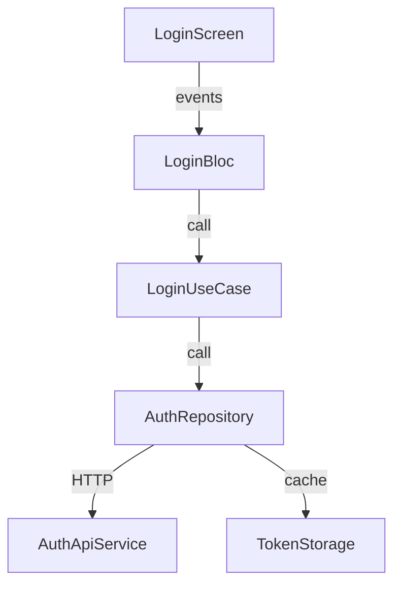

# Ví dụ — Plan Structure (User Login Feature)

> Đây là mẫu output chuẩn cho Plan Agent khi thiết kế kiến trúc.

---

## 1. Overview

Feature User Login implement authentication flow với email/password. Sử dụng Clean Architecture theo constitution, tách rõ data → domain → presentation layers.

## 2. Component Diagram

## 3. File Structure

| File Path | Type | Description |
|-----------|------|-------------|
| `lib/features/auth/presentation/login_screen.dart` | NEW | Login UI |
| `lib/features/auth/presentation/login_bloc.dart` | NEW | State management |
| `lib/features/auth/domain/login_usecase.dart` | NEW | Business logic |
| `lib/features/auth/domain/auth_repository.dart` | NEW | Repository interface |
| `lib/features/auth/data/auth_repository_impl.dart` | NEW | Repository implementation |
| `lib/features/auth/data/auth_api_service.dart` | NEW | API client |
| `lib/core/storage/token_storage.dart` | MODIFY | Add auth token methods |

⚠️ No-Go Zone check: `token_storage.dart` OK — not in No-Go Zone (verified context.md §4).

## 4. REQ ↔ Component Matrix

| REQ | Component(s) | Responsibility |
|-----|-------------|----------------|
| REQ-E01 | LoginScreen, LoginBloc, LoginUseCase, AuthRepository | Login success flow |
| REQ-E02 | LoginBloc, LoginUseCase | Invalid credentials handling |
| REQ-U01 | AuthApiService | Password security (hash before send) |
| REQ-O01 | LoginBloc | Rate limiting (> 5 attempts) |

## 5. Error Architecture

| Error Type | HTTP Code | Handler | User Message |
|-----------|----------|---------|--------------|
| InvalidCredentials | 401 | LoginBloc | "Email hoặc mật khẩu không đúng" |
| AccountLocked | 423 | LoginBloc | "Tài khoản bị khóa, liên hệ support" |
| NetworkError | - | LoginBloc | "Không có kết nối mạng" |
| ServerError | 500 | LoginBloc | "Hệ thống lỗi, thử lại sau" |

## 6. Tech Decisions

- **BLoC pattern**: Theo constitution §3.2 — state management cho Flutter.
- **Repository pattern**: Interface tại domain boundary → testable với mock.
- **WHY không modify legacy SSO**: No-Go Zone — tạo adapter thay vì modify.
