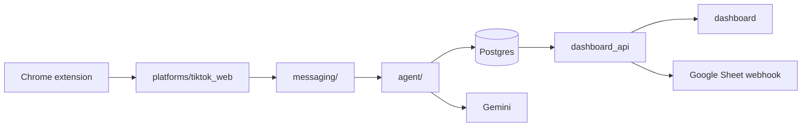

# Technical Plan — autonomous-agent-vflow (baseline)

> Plan Agent · Spec v1.0. Baseline legacy: **không thiết kế lại**, chỉ đặc tả hóa và khóa hành vi bằng test.

## 1. Tổng quan kiến trúc
### 1.1 Tóm tắt
Giữ kiến trúc hiện tại (xem `context.md` §2). Công việc là characterization test theo từng luồng UC, ưu tiên các chốt an toàn (idempotency, validator, handoff, tenancy).

### 1.2 Diagram

### 1.3 Components liên quan
`agent/`, `messaging/`, `platforms/`, `storage/`, `services/`, `dashboard_api/`, `integrations/`.

## 2. Tech Stack & Dependencies
Không thêm dependency mới. Test dùng `pytest` có sẵn (dependency-group `dev`).

## 3. Data Model
Không đổi schema. Bảng liên quan: `message_events`, `outbound_messages`, `inbox_ledger`, `message_escalations`, `conversations`, `notifications`.
### 3.4 Database Migrations
Không có migration mới (T-001 chỉ xác minh).

## 4. API Design
Không đổi contract. Endpoint dưới test: `POST /api/accounts/{id}/conversations/{cid}/takeover|release|messages`, `POST /api/auth/login`, `POST /api/accounts/{id}/start|stop|pause|resume`, `/api/accounts/{id}/orders`.

## 5. UI / Screen Changes
Không có.

## 6. File Changes
### 6.1 File mới
Test mới trong `tests/` cho khoảng trống (T-003…T-016) nếu chưa có test tương ứng.
### 6.2 File sửa đổi
Chỉ sửa code production khi test đặc tả đỏ do lệch spec.

## 7. Rủi ro kỹ thuật
| ID | Rủi ro | Giảm thiểu |
|----|--------|-----------|
| R-01 | Test cần Chrome/Gemini thật | Dùng fake adapter + fake LLM; tách test eval khỏi CI |
| R-02 | Spec AI-inferred lệch hành vi thật | Ghi concern, BA xác nhận |

## 8. Constitution Compliance Check
Tuân thủ §3.1–3.4 (an toàn nghiệp vụ) — chính các AC-02/05/06/07 khóa các luật này.

## 9. No-Go Zone Verification
Không sửa migration cũ, `control/server.py` bind, `auth.py`/`cf_access.py`. T-010/T-013/T-014 chỉ **thêm test**, không đổi logic bảo mật.

## 10. NFR
Test phải chạy offline, không cần credential.

## 11. Observability & Rollout
Không đổi; không rollout.

## 12. Giả định & Câu hỏi mở
- Giả định: hành vi `ReplyValidator`/`ShopPolicy` đúng như mô tả AC-06/07 (chưa đọc chi tiết) — **[W-001]**.
- Mở: ngưỡng coverage mục tiêu (constitution §6).

## 13. Tech Decisions
Chọn characterization test thay vì rewrite: giữ hành vi production đang chạy.

## 14. Truy vết REQ → Thiết kế

| REQ | Thành phần / cách đảm bảo |
|-----|---------------------------|
| REQ-U01 | `storage/tenancy.py`, `scope.py` — lọc `account_id` (T-001, T-002) |
| REQ-U02 | `agent/reply_validator.py`, `shop_policy.py` (T-007, T-008) |
| REQ-U03 | `storage/inbox_ledger.py`, `memory/processed_messages.py` (T-004) |
| REQ-E01 | `messaging/scan_scheduler.py` → `agent/reply_service.py` (T-003, T-004) |
| REQ-E02 | `agent/unsupported_message.py` (T-005) |
| REQ-E03 | `services/handoff.py` (T-006) |
| REQ-E04 | Fallback strong LLM / handoff trong `reply_service.py` (T-007) |
| REQ-E05 | `storage/conversation_control.py`, `dashboard_api` (T-009, T-013) |
| REQ-E06 | `POST .../messages` (T-009) |
| REQ-E07 | `integrations/sheet_export.py` (T-015, T-016) |
| REQ-S01 | Kiểm takeover trước khi gửi (T-009, T-012) |
| REQ-S02 | `messaging/followup_scheduler.py` (T-011, T-012) |
| REQ-O01 | `agent/product_lookup.py` (T-008) |
| REQ-O02 | Authz trong `dashboard_api` (T-010, T-014) |
| REQ-O03 | `dashboard_api/cf_access.py` (T-014) |
