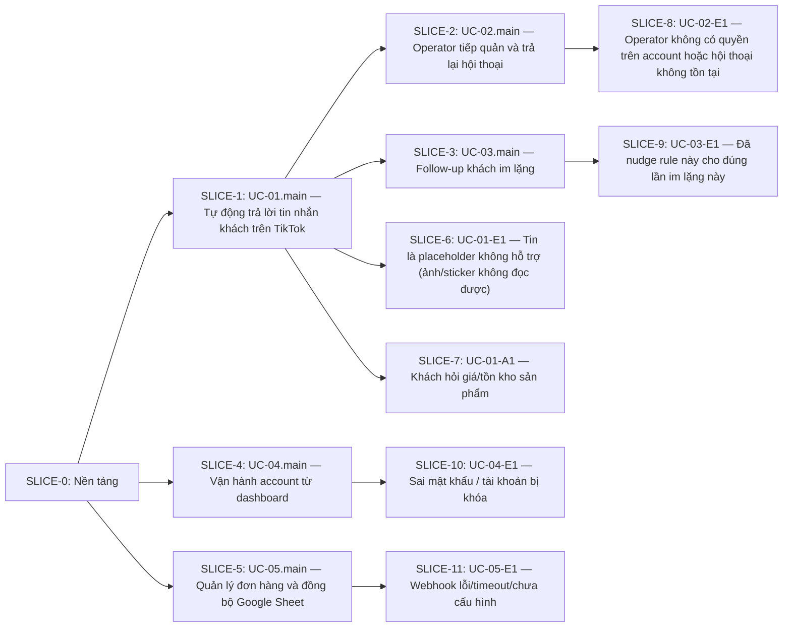

# Slice Plan — main-first

> Sinh tự động từ `slicing/variants/main-first.yaml` bởi `v-flow slice use`. Không sửa tay —
> sửa variant rồi chạy lại `v-flow slice use`.

| Thông tin | Giá trị |
|---|---|
| Variant | main-first |
| Strategy | main-first |
| Tham số | {"foundation":"auto","hub_policy":"first-consumer","group_alt":"per-uc","defer":[],"max_points":8} |
| Graph hash | e7dc5f25 |
| Spec version | v1.0 |
| Trạng thái | 🔒 Khóa bởi AutoSystem lúc 2026-11-03T02:04:57.889Z |

## Các slice (theo thứ tự)

| Slice | Tên | Luồng | Task | Điểm | Phụ thuộc | Loại |
|---|---|---|---|---:|---|---|
| SLICE-0 | Nền tảng | — | T-001, T-002 | 3 | — | AFK |
| SLICE-1 | UC-01.main — Tự động trả lời tin nhắn khách trên TikTok | UC-01.main | T-003, T-004 | 6 | SLICE-0 | AFK |
| SLICE-2 | UC-02.main — Operator tiếp quản và trả lại hội thoại | UC-02.main | T-009 | 2 | SLICE-1 | AFK |
| SLICE-3 | UC-03.main — Follow-up khách im lặng | UC-03.main | T-011 | 2 | SLICE-1 | AFK |
| SLICE-4 | UC-04.main — Vận hành account từ dashboard | UC-04.main | T-013 | 4 | SLICE-0 | AFK |
| SLICE-5 | UC-05.main — Quản lý đơn hàng và đồng bộ Google Sheet | UC-05.main | T-015 | 2 | SLICE-0 | AFK |
| SLICE-6 | UC-01-E1 — Tin là placeholder không hỗ trợ (ảnh/sticker không đọc được) | UC-01-E1, UC-01-E2, UC-01-E3 | T-005, T-006, T-007 | 7 | SLICE-1 | AFK |
| SLICE-7 | UC-01-A1 — Khách hỏi giá/tồn kho sản phẩm | UC-01-A1 | T-008 | 2 | SLICE-1 | AFK |
| SLICE-8 | UC-02-E1 — Operator không có quyền trên account hoặc hội thoại không tồn tại | UC-02-E1, UC-02-E2 | T-010 | 2 | SLICE-2 | AFK |
| SLICE-9 | UC-03-E1 — Đã nudge rule này cho đúng lần im lặng này | UC-03-E1, UC-03-E2 | T-012 | 1 | SLICE-3 | AFK |
| SLICE-10 | UC-04-E1 — Sai mật khẩu / tài khoản bị khóa | UC-04-E1, UC-04-E2, UC-04-A1 | T-014 | 2 | SLICE-4 | AFK |
| SLICE-11 | UC-05-E1 — Webhook lỗi/timeout/chưa cấu hình | UC-05-E1 | T-016 | 2 | SLICE-5 | HITL |

## Đồ thị phụ thuộc

## Chi tiết

### SLICE-0: Nền tảng

- **Demo**: DB trống áp dụng schema + migration sạch và dữ liệu account A không lộ sang account B (AC-01)
- **Luồng**: —
- **Task**: T-001, T-002
- **AC (suy ra từ graph)**: AC-01
- **TC (suy ra từ graph)**: TC-01, TC-02
- **Phụ thuộc**: — · **Loại**: AFK

### SLICE-1: UC-01.main — Tự động trả lời tin nhắn khách trên TikTok

- **Demo**: Khách nhắn tin mới → agent gửi đúng một trả lời đã validate, restart không gửi trùng (AC-02, AC-03)
- **Luồng**: UC-01.main
- **Task**: T-003, T-004
- **AC (suy ra từ graph)**: AC-01, AC-02, AC-03, AC-04, AC-05, AC-06, AC-07
- **TC (suy ra từ graph)**: TC-01, TC-02, TC-03, TC-04, TC-05, TC-06, TC-07, TC-08, TC-09
- **Phụ thuộc**: SLICE-0 · **Loại**: AFK

### SLICE-2: UC-02.main — Operator tiếp quản và trả lại hội thoại

- **Demo**: Operator takeover, gửi tin tay rồi release; trong lúc takeover agent không tự trả lời (AC-08, AC-09)
- **Luồng**: UC-02.main
- **Task**: T-009
- **AC (suy ra từ graph)**: AC-08, AC-09, AC-10
- **TC (suy ra từ graph)**: TC-10, TC-11, TC-12
- **Phụ thuộc**: SLICE-1 · **Loại**: AFK

### SLICE-3: UC-03.main — Follow-up khách im lặng

- **Demo**: Khách im lặng đủ ngưỡng nhận đúng một tin follow-up (AC-11)
- **Luồng**: UC-03.main
- **Task**: T-011
- **AC (suy ra từ graph)**: AC-11
- **TC (suy ra từ graph)**: TC-13, TC-14
- **Phụ thuộc**: SLICE-1 · **Loại**: AFK

### SLICE-4: UC-04.main — Vận hành account từ dashboard

- **Demo**: Operator đăng nhập, start/pause/resume agent và thấy trạng thái cập nhật qua WebSocket (AC-13)
- **Luồng**: UC-04.main
- **Task**: T-013
- **AC (suy ra từ graph)**: AC-12, AC-13
- **TC (suy ra từ graph)**: TC-15, TC-16
- **Phụ thuộc**: SLICE-0 · **Loại**: AFK

### SLICE-5: UC-05.main — Quản lý đơn hàng và đồng bộ Google Sheet

- **Demo**: Operator tạo đơn và đơn hiển thị theo đúng account (AC-14)
- **Luồng**: UC-05.main
- **Task**: T-015
- **AC (suy ra từ graph)**: AC-14
- **TC (suy ra từ graph)**: TC-17, TC-18
- **Phụ thuộc**: SLICE-0 · **Loại**: AFK

### SLICE-6: UC-01-E1 — Tin là placeholder không hỗ trợ (ảnh/sticker không đọc được)

- **Demo**: Tin placeholder → câu xác nhận đúng ngôn ngữ; yêu cầu người thật → escalation; LLM lỗi → không gửi nội dung chưa kiểm (AC-04, AC-05, AC-06)
- **Luồng**: UC-01-E1, UC-01-E2, UC-01-E3
- **Task**: T-005, T-006, T-007
- **AC (suy ra từ graph)**: AC-04, AC-05, AC-06, AC-07
- **TC (suy ra từ graph)**: TC-06, TC-07, TC-08, TC-09
- **Phụ thuộc**: SLICE-1 · **Loại**: AFK

### SLICE-7: UC-01-A1 — Khách hỏi giá/tồn kho sản phẩm

- **Demo**: Khách hỏi giá/tồn kho → trả lời khớp dữ liệu sản phẩm thật (AC-07)
- **Luồng**: UC-01-A1
- **Task**: T-008
- **AC (suy ra từ graph)**: AC-07
- **TC (suy ra từ graph)**: TC-09
- **Phụ thuộc**: SLICE-1 · **Loại**: AFK

### SLICE-8: UC-02-E1 — Operator không có quyền trên account hoặc hội thoại không tồn tại

- **Demo**: Operator không quyền nhận 403 và trạng thái hội thoại không đổi (AC-10)
- **Luồng**: UC-02-E1, UC-02-E2
- **Task**: T-010
- **AC (suy ra từ graph)**: AC-10
- **TC (suy ra từ graph)**: TC-12
- **Phụ thuộc**: SLICE-2 · **Loại**: AFK

### SLICE-9: UC-03-E1 — Đã nudge rule này cho đúng lần im lặng này

- **Demo**: Cùng một lần im lặng, follow-up không lặp; takeover/ngoài giờ thì hoãn (AC-11)
- **Luồng**: UC-03-E1, UC-03-E2
- **Task**: T-012
- **AC (suy ra từ graph)**: AC-11
- **TC (suy ra từ graph)**: TC-13, TC-14
- **Phụ thuộc**: SLICE-3 · **Loại**: AFK

### SLICE-10: UC-04-E1 — Sai mật khẩu / tài khoản bị khóa

- **Demo**: Sai mật khẩu, vượt quota hoặc JWT Cloudflare sai đều bị từ chối (AC-12)
- **Luồng**: UC-04-E1, UC-04-E2, UC-04-A1
- **Task**: T-014
- **AC (suy ra từ graph)**: AC-12
- **TC (suy ra từ graph)**: TC-16
- **Phụ thuộc**: SLICE-4 · **Loại**: AFK

### SLICE-11: UC-05-E1 — Webhook lỗi/timeout/chưa cấu hình

- **Demo**: Webhook Sheet lỗi nhưng đơn vẫn được lưu và thao tác không bị chặn (AC-14)
- **Luồng**: UC-05-E1
- **Task**: T-016
- **AC (suy ra từ graph)**: AC-14
- **TC (suy ra từ graph)**: TC-17, TC-18
- **Phụ thuộc**: SLICE-5 · **Loại**: HITL
