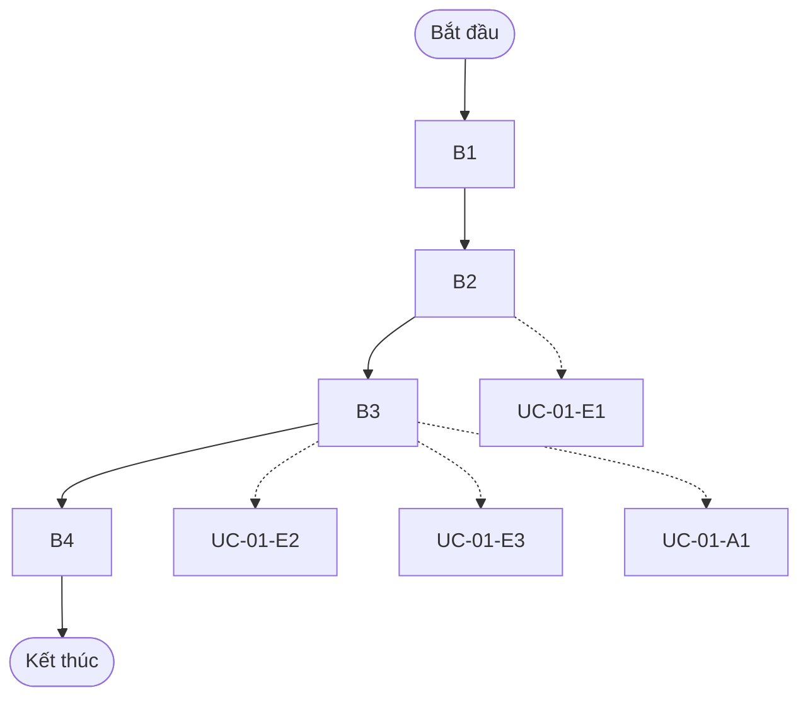
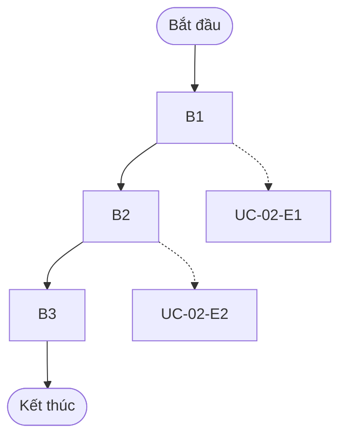
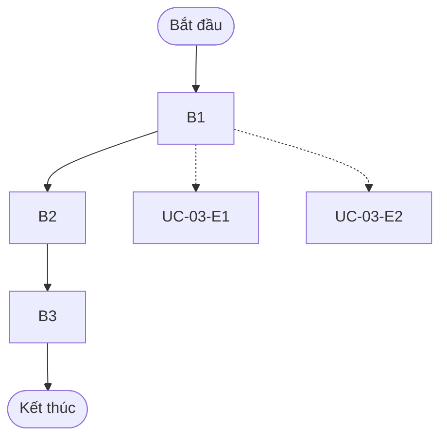
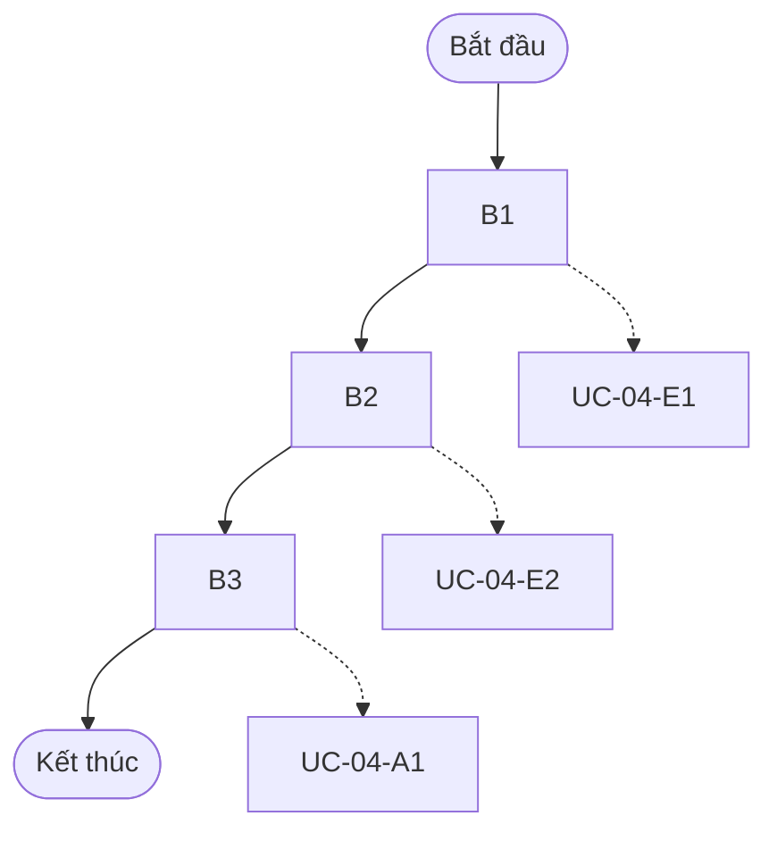
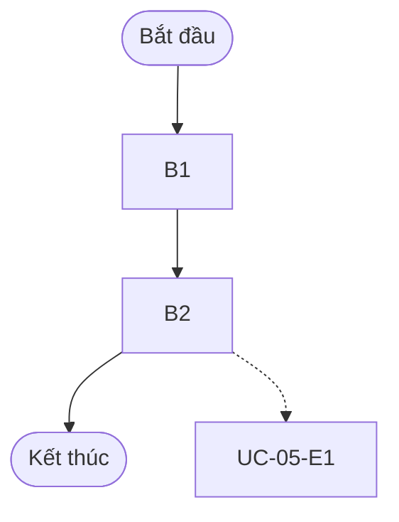
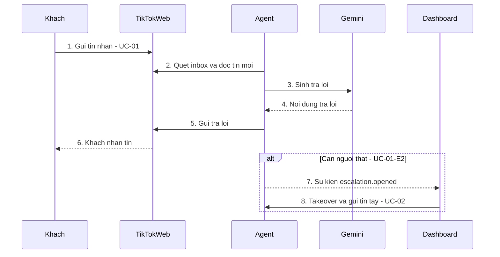

# Specification — autonomous-agent-vflow (baseline)

> 📌 **Single Source of Truth**. Feature: `001-autonomous-agent-vflow` — baseline hóa hệ thống legacy hiện có.
> Spec mô tả **hành vi thực tế suy từ code** `[⚠️ AI-inferred]`; BA/Tech Lead cần review trước khi coi là approved.

## 1. Tổng quan

### 1.1 Mô tả ngắn gọn
Agent tự động chăm sóc khách hàng trên TikTok Web (inbox DM) qua Chrome, kèm dashboard đa account để operator giám sát, tiếp quản và quản lý đơn hàng.

### 1.2 Động lực (Motivation)
Hệ thống đã chạy nhưng chưa có spec/plan/test/slice theo V Flow. Baseline này tạo nền truy vết REQ→Task→Test→Slice để các thay đổi sau đi đúng pipeline.

### 1.3 Actors

| Actor | Mô tả | Quyền hạn |
|-------|-------|----------|
| Khách hàng | Người nhắn tin cho shop trên TikTok | Chỉ nhắn tin |
| Operator | Nhân viên shop dùng dashboard | Theo workspace/account được cấp |
| Admin | Quản trị dashboard | Quản lý user, `max-workspaces`, access |
| Hệ thống (Agent) | Tiến trình agent mỗi account | Đọc/ghi DB của account mình |

---

## 2. Đặc tả Use Case chi tiết

### UC-01: Tự động trả lời tin nhắn khách trên TikTok

| Thuộc tính | Nội dung |
|-----------|----------|
| **Mã** | UC-01 |
| **Mô tả tính năng** | Agent quét inbox TikTok, phân tích tin mới của khách, sinh câu trả lời (LLM) đã qua kiểm tra an toàn và gửi lại, đảm bảo không gửi trùng. |
| **Tác nhân chính** | Hệ thống (Agent) |
| **Tác nhân phụ** | Khách hàng, Gemini LLM, TikTok Web |
| **Độ ưu tiên** | Cao |
| **Tần suất sử dụng** | Liên tục (mỗi chu kỳ quét) |

**Điều kiện trước (Preconditions)**:
- [ ] Account đã đăng nhập TikTok và agent đang chạy, không bị pause
- [ ] Hội thoại không ở trạng thái takeover

**Điều kiện sau (Postconditions)**:
- [ ] Tin trả lời đã gửi và ghi vào lịch sử hội thoại
- [ ] `inbox_ledger` đánh dấu tin đã xử lý (idempotent)

**Luồng sự kiện chính (Main Flow)**:

| # | Hành động của tác nhân | Phản ứng của hệ thống |
|---|------------------------|------------------------|
| 1 | Quét inbox, phát hiện hội thoại chưa đọc | Mở hội thoại, trích tin mới thành `MessageEvent` |
| 2 | — | Phân tích tin và định tuyến (`MessageRouter`) |
| 3 | — | Tra cứu sản phẩm/ngữ cảnh khi cần, sinh trả lời, kiểm tra bằng `ReplyValidator` |
| 4 | — | Gửi tin qua extension, ghi `outbound_messages` + ledger |

**Luồng ngoại lệ & thay thế (Exceptions / Alternative Flows)**:

| Mã | Tại bước | Điều kiện kích hoạt | Xử lý của hệ thống |
|----|----------|---------------------|---------------------|
| UC-01-E1 | B2 | Tin là placeholder không hỗ trợ (ảnh/sticker không đọc được) | Gửi câu xác nhận theo ngôn ngữ khách, không gọi LLM sinh nội dung |
| UC-01-E2 | B3 | Khách yêu cầu người thật / agent không chắc / chủ đề nhạy cảm | Mở handoff (`message_escalations`), phát `escalation.opened`, dừng tự động trả lời |
| UC-01-E3 | B3 | LLM lỗi/timeout hoặc `ReplyValidator` từ chối | Thử strong LLM / reply an toàn dự phòng; nếu vẫn lỗi thì handoff, không gửi nội dung chưa kiểm |
| UC-01-A1 | B3 | Khách hỏi giá/tồn kho sản phẩm | Tra cứu `ProductLookupPolicy`, chỉ dùng dữ liệu thật; thiếu dữ liệu → hỏi lại/handoff |

**Workflow (sơ đồ luồng)**:

**Yêu cầu đặc biệt (NFR)**: Hiệu năng: có `ReplyTimer` ghi thời gian trả lời. Bảo mật: không log PII thô. Tuân thủ: không bịa giá/tồn kho/đơn/hoàn tiền.

**Mô tả màn hình (Screen / UI)**: Không có UI trực tiếp (chạy nền).

---

### UC-02: Operator tiếp quản và trả lại hội thoại

| Thuộc tính | Nội dung |
|-----------|----------|
| **Mã** | UC-02 |
| **Mô tả tính năng** | Operator dashboard takeover một hội thoại, nhắn tay cho khách rồi release để agent tiếp tục. |
| **Tác nhân chính** | Operator |
| **Tác nhân phụ** | Agent |
| **Độ ưu tiên** | Cao |
| **Tần suất sử dụng** | Hàng ngày |

**Điều kiện trước (Preconditions)**:
- [ ] Operator đã đăng nhập và có quyền trên account
- [ ] Hội thoại tồn tại

**Điều kiện sau (Postconditions)**:
- [ ] Trạng thái takeover/release được lưu
- [ ] Tin operator gửi nằm trong lịch sử

**Luồng sự kiện chính (Main Flow)**:

| # | Hành động của tác nhân | Phản ứng của hệ thống |
|---|------------------------|------------------------|
| 1 | Bấm Takeover trên hội thoại | `POST .../takeover` ghi `conversation_control`, agent ngừng tự trả lời |
| 2 | Nhập và gửi tin | `POST .../messages` xếp tin gửi qua extension |
| 3 | Bấm Release | `POST .../release` trả quyền cho agent |

**Luồng ngoại lệ & thay thế (Exceptions / Alternative Flows)**:

| Mã | Tại bước | Điều kiện kích hoạt | Xử lý của hệ thống |
|----|----------|---------------------|---------------------|
| UC-02-E1 | B1 | Operator không có quyền trên account hoặc hội thoại không tồn tại | Trả 403/404, không đổi trạng thái |
| UC-02-E2 | B2 | Gửi tin thất bại (extension/TikTok lỗi) | Báo lỗi phân loại cho operator, giữ takeover, không đánh dấu đã gửi |

**Workflow (sơ đồ luồng)**:

**Yêu cầu đặc biệt (NFR)**: Bảo mật: kiểm quyền theo account. Hiệu năng: takeover chỉ 2 query có chỉ mục, không chờ vòng agent.

**Mô tả màn hình (Screen / UI)**: Dashboard React (`dashboard/src`) — danh sách hội thoại, trạng thái account, đơn hàng.

---

### UC-03: Follow-up khách im lặng

| Thuộc tính | Nội dung |
|-----------|----------|
| **Mã** | UC-03 |
| **Mô tả tính năng** | Hệ thống nhắc lại khách đã ngừng phản hồi theo rule đã cấu hình, mỗi lần im lặng tối đa một lần. |
| **Tác nhân chính** | Hệ thống (FollowUpScheduler) |
| **Tác nhân phụ** | Khách hàng |
| **Độ ưu tiên** | Trung bình |
| **Tần suất sử dụng** | Theo lịch |

**Điều kiện trước (Preconditions)**:
- [ ] Follow-up được bật cho account
- [ ] Hội thoại có ≥1 tin thật của khách và tin cuối là của shop

**Điều kiện sau (Postconditions)**:
- [ ] Tin follow-up đã gửi và ghi nhận (rule, tin cuối của khách)

**Luồng sự kiện chính (Main Flow)**:

| # | Hành động của tác nhân | Phản ứng của hệ thống |
|---|------------------------|------------------------|
| 1 | Scheduler duyệt hội thoại | Lọc hội thoại im lặng đủ ngưỡng thời gian của rule |
| 2 | — | Sinh tin follow-up và gửi như UC-01 |
| 3 | — | Ghi nhận để không lặp lại cùng rule cho cùng tin cuối |

**Luồng ngoại lệ & thay thế (Exceptions / Alternative Flows)**:

| Mã | Tại bước | Điều kiện kích hoạt | Xử lý của hệ thống |
|----|----------|---------------------|---------------------|
| UC-03-E1 | B1 | Đã nudge rule này cho đúng lần im lặng này | Bỏ qua |
| UC-03-E2 | B1 | Ngoài giờ hoạt động hoặc hội thoại đang takeover | Hoãn, không gửi |

**Workflow (sơ đồ luồng)**:

**Yêu cầu đặc biệt (NFR)**: Tuân thủ: không bao giờ nhắn người lạ chưa từng nói chuyện.

**Mô tả màn hình (Screen / UI)**: Không có UI trực tiếp (chạy nền).

---

### UC-04: Vận hành account từ dashboard

| Thuộc tính | Nội dung |
|-----------|----------|
| **Mã** | UC-04 |
| **Mô tả tính năng** | Operator đăng nhập dashboard, khởi động/dừng/tạm dừng agent của từng account và theo dõi trạng thái thời gian thực. |
| **Tác nhân chính** | Operator |
| **Tác nhân phụ** | Supervisor, Agent |
| **Độ ưu tiên** | Cao |
| **Tần suất sử dụng** | Hàng ngày |

**Điều kiện trước (Preconditions)**:
- [ ] Tài khoản dashboard đã được tạo và kích hoạt

**Điều kiện sau (Postconditions)**:
- [ ] Agent ở trạng thái mong muốn; status hiển thị qua WebSocket

**Luồng sự kiện chính (Main Flow)**:

| # | Hành động của tác nhân | Phản ứng của hệ thống |
|---|------------------------|------------------------|
| 1 | Đăng nhập | `POST /api/auth/login` cấp cookie phiên |
| 2 | Chọn account, bấm Start | `POST /api/accounts/{id}/start` chạy tiến trình agent |
| 3 | Xem trạng thái | Hub đẩy status SSE→WS; có thể pause/resume |

**Luồng ngoại lệ & thay thế (Exceptions / Alternative Flows)**:

| Mã | Tại bước | Điều kiện kích hoạt | Xử lý của hệ thống |
|----|----------|---------------------|---------------------|
| UC-04-E1 | B1 | Sai mật khẩu / tài khoản bị khóa | Từ chối đăng nhập, không lộ lý do chi tiết |
| UC-04-E2 | B2 | Vượt `max-workspaces` hoặc không có quyền account | Từ chối start |
| UC-04-A1 | B3 | Operator pause/resume | Gọi `/pause` `/resume`, agent dừng/tiếp tục nhận tác vụ |

**Workflow (sơ đồ luồng)**:

**Yêu cầu đặc biệt (NFR)**: Bảo mật: cookie HS256 + bcrypt, Cloudflare Access tùy chọn.

**Mô tả màn hình (Screen / UI)**: Dashboard React (`dashboard/src`) — danh sách hội thoại, trạng thái account, đơn hàng.

---

### UC-05: Quản lý đơn hàng và đồng bộ Google Sheet

| Thuộc tính | Nội dung |
|-----------|----------|
| **Mã** | UC-05 |
| **Mô tả tính năng** | Operator tạo/cập nhật đơn; trạng thái khách và đơn được đẩy một chiều sang Google Sheet. |
| **Tác nhân chính** | Operator |
| **Tác nhân phụ** | Google Apps Script webhook |
| **Độ ưu tiên** | Trung bình |
| **Tần suất sử dụng** | Hàng ngày |

**Điều kiện trước (Preconditions)**:
- [ ] Operator có quyền trên account

**Điều kiện sau (Postconditions)**:
- [ ] Đơn được lưu; bản sao trên Sheet được cập nhật (best-effort)

**Luồng sự kiện chính (Main Flow)**:

| # | Hành động của tác nhân | Phản ứng của hệ thống |
|---|------------------------|------------------------|
| 1 | Tạo/cập nhật đơn trên dashboard | `routes/orders.py` lưu đơn theo account |
| 2 | — | `sheet_export.export_order` gửi webhook không đồng bộ |

**Luồng ngoại lệ & thay thế (Exceptions / Alternative Flows)**:

| Mã | Tại bước | Điều kiện kích hoạt | Xử lý của hệ thống |
|----|----------|---------------------|---------------------|
| UC-05-E1 | B2 | Webhook lỗi/timeout/chưa cấu hình | Ghi log, không chặn thao tác của operator, không rollback đơn |

**Workflow (sơ đồ luồng)**:

**Yêu cầu đặc biệt (NFR)**: Hiệu năng: gửi nền (`_spawn`) có cổng in-flight. Tuân thủ: Sheet chỉ là bản sao, DB là nguồn sự thật.

**Mô tả màn hình (Screen / UI)**: Dashboard React (`dashboard/src`) — danh sách hội thoại, trạng thái account, đơn hàng.

---

### Sequence Diagram — Tương tác tổng thể

---

## 3. Requirements (EARS)

### 3.1 Phổ quát (Ubiquitous)
- **REQ-U01**: Hệ thống phải cô lập mọi dữ liệu nghiệp vụ theo `account_id`.
- **REQ-U02**: Hệ thống không được gửi nội dung giá, tồn kho, trạng thái đơn, hoàn tiền hoặc thanh toán không có trong dữ liệu thật.
- **REQ-U03**: Hệ thống phải đảm bảo mỗi tin đến chỉ được xử lý và trả lời một lần (idempotent qua ledger/lease).

### 3.2 Theo sự kiện (Event-driven)
- **REQ-E01**: Khi phát hiện tin mới của khách, hệ thống phải phân tích, định tuyến, sinh trả lời đã kiểm và gửi lại.
- **REQ-E02**: Khi tin là placeholder không hỗ trợ, hệ thống phải gửi câu xác nhận theo ngôn ngữ khách.
- **REQ-E03**: Khi cần người thật, hệ thống phải mở escalation, phát sự kiện và dừng tự trả lời hội thoại đó.
- **REQ-E04**: Khi LLM lỗi hoặc validator từ chối, hệ thống phải dùng đường dự phòng an toàn hoặc handoff, không gửi nội dung chưa kiểm.
- **REQ-E05**: Khi operator takeover, hệ thống phải ngừng tự trả lời; khi release phải cho phép agent tiếp tục.
- **REQ-E06**: Khi operator gửi tin tay, hệ thống phải gửi qua extension và ghi vào lịch sử.
- **REQ-E07**: Khi đơn được tạo/cập nhật, hệ thống phải đẩy bản sao sang Google Sheet mà không chặn thao tác.

### 3.3 Theo trạng thái (State-driven)
- **REQ-S01**: Trong khi hội thoại ở trạng thái takeover, agent không được tự gửi tin (kể cả follow-up).
- **REQ-S02**: Trong khi hội thoại im lặng đủ ngưỡng và chưa nudge cho tin cuối của khách, hệ thống phải gửi follow-up đúng một lần.

### 3.4 Có điều kiện (Optional)
- **REQ-O01**: Nếu khách hỏi về sản phẩm, hệ thống phải tra cứu bằng `ProductLookupPolicy` và chỉ dùng dữ liệu tìm được.
- **REQ-O02**: Nếu operator không có quyền trên account hoặc vượt `max-workspaces`, hệ thống phải từ chối thao tác.
- **REQ-O03**: Nếu Cloudflare Access được bật, hệ thống phải xác minh JWT RS256 trước khi cấp phiên.

---

## 4. Acceptance Criteria

| Mã | Use Case | Requirement | Tiêu chí | Cách kiểm tra |
|----|----------|------------|---------|---------------|
| AC-01 | UC-01 | REQ-U01 | Truy vấn account A không trả dữ liệu account B | Test cô lập (`test_account_isolation.py`) |
| AC-02 | UC-01 | REQ-U03 | Xử lý lại cùng tin (restart) không gửi trùng | Test ledger/lease |
| AC-03 | UC-01 | REQ-E01 | Tin mới → đúng một tin trả lời đã qua validator được gửi | Integration với fake adapter + fake LLM |
| AC-04 | UC-01 | REQ-E02 | Placeholder không hỗ trợ → câu xác nhận đúng ngôn ngữ, không gọi LLM | Unit |
| AC-05 | UC-01 | REQ-E03 | Yêu cầu người thật → có dòng `message_escalations` + sự kiện, không trả lời tiếp | Integration |
| AC-06 | UC-01 | REQ-E04 | LLM lỗi/validator từ chối → không gửi nội dung chưa kiểm | Unit với LLM giả lỗi |
| AC-07 | UC-01 | REQ-U02, REQ-O01 | Trả lời giá/tồn kho chỉ khớp dữ liệu sản phẩm | Unit validator + product lookup |
| AC-08 | UC-02 | REQ-E05, REQ-S01 | Takeover chặn auto-reply; release khôi phục | Integration |
| AC-09 | UC-02 | REQ-E06 | Tin operator xuất hiện trong lịch sử và được gửi | API test |
| AC-10 | UC-02 | REQ-O02 | Không quyền → 403, trạng thái không đổi | API test |
| AC-11 | UC-03 | REQ-S02 | Follow-up gửi đúng một lần cho mỗi (rule, tin cuối của khách) | Unit scheduler |
| AC-12 | UC-04 | REQ-O02, REQ-O03 | Đăng nhập sai bị từ chối; vượt quota bị chặn; CF Access JWT sai bị từ chối | API test |
| AC-13 | UC-04 | REQ-E05 | Start/stop/pause/resume đổi trạng thái agent và hub đẩy status | Integration |
| AC-14 | UC-05 | REQ-E07 | Webhook lỗi không làm hỏng thao tác đơn | Unit với webhook giả lỗi |

---

## 5. Ràng buộc & Giả định

### 5.1 Ràng buộc
- [ ] Python ≥3.10, PostgreSQL 16, Chrome + extension; control server bind loopback.
- [ ] Chỉ thêm migration mới, không sửa migration đã áp dụng.

### 5.2 Giả định
- [ ] Spec phản ánh hành vi hiện tại `[⚠️ AI-inferred]`, cần BA xác nhận.
- [ ] Hành vi cụ thể của `ReplyValidator`/`ShopPolicy` chưa được đọc chi tiết; AC-06/AC-07 cần xác minh khi plan.

### 5.3 Ngoài phạm vi
- [ ] Nền tảng ngoài TikTok Web, thanh toán, cold-message khách lạ, thay đổi UI dashboard.

---

## 6. Rủi ro & Phụ thuộc

| Rủi ro / Phụ thuộc | Mức độ | Giải pháp |
|--------------------|--------|----------|
| DOM TikTok đổi làm vỡ selector | Cao | Fallback grounding/vision, test fixture DOM |
| Phụ thuộc Gemini (chi phí, quota, lỗi) | Trung bình | Strong/weak LLM, handoff khi lỗi |
| Gửi trùng tin khi restart | Cao | Ledger + lease (đã có), giữ test |

---

## 7. Status

| Thông tin | Giá trị |
|-----------|--------|
| **Spec Version** | v1.0 |
| **Trạng thái** | `Draft` (AI-generated, chờ human review) |
| **Người approve** | *(chưa)* |
| **Ngày approve** | *(chưa)* |

### Artifact Sync Status

| Artifact | Synced to Spec | Trạng thái | Ghi chú |
|----------|---------------|------------|--------|
| `plan.md` | v1.0 | ✅ | |
| `tasks.md` | v1.0 | ✅ | |
| `test-cases.md` | v1.0 | ✅ | |
| `slices.md` | v1.0 | ✅ | khóa bởi AutoSystem |
| `validation-report.md` | v1.0 | ✅ | |

### Changelog

| Version | Ngày | Thay đổi | Người thực hiện |
|---------|------|----------|------------------|
| v1.0 | 2026-11-03 | Baseline từ code | BA Agent (AI) |
