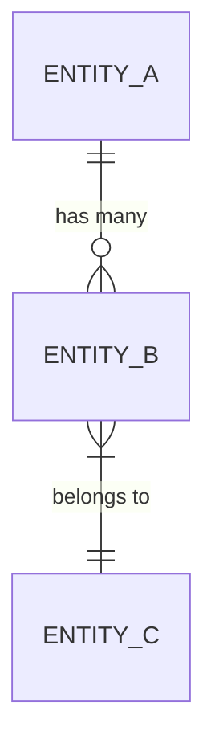
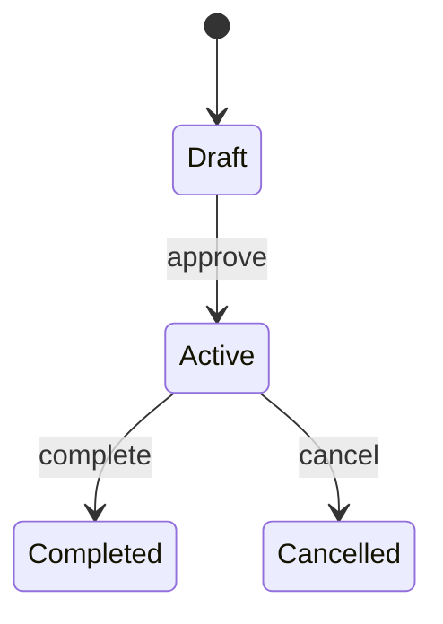

# Template: Data Model

> Được tạo bởi **Plan Agent** — Phase B.0a (khi feature có data model rõ ràng)
> Lưu tại `data-model.md`
> Feature: [TÊN FEATURE]
> Spec Version: [vX.Y]

> 📌 Khi có **cả FE và BE** (contract-first): đóng băng data model TRƯỚC, cùng với `contracts/api-contract.md`. FE và BE đều `[DEPENDS]` vào task chốt model này rồi mới `[PARALLEL]`.

---

## 1. Entities

> Mỗi entity: field (tên / kiểu / bắt buộc / ý nghĩa nghiệp vụ). KHÔNG bịa field ngoài spec.

```
[EntityName]
├── id: uuid (required) — khóa chính
├── field1: type (required) — [ý nghĩa nghiệp vụ]
├── field2: type (optional) — [ý nghĩa]
└── field3: type — [ý nghĩa]
```

| Entity | Nguồn (REQ/UC) | Persistence | Ghi chú |
|--------|----------------|-------------|---------|
| `[Entity]` | REQ-xxx (UC-xx) | DB table / DTO / state | |

---

## 2. Relationships



| Quan hệ | Loại | Ràng buộc (FK / cascade) |
|---------|------|--------------------------|
| A → B | 1-n | FK `b.a_id`, on delete cascade |

---

## 3. State Machine (nếu entity có vòng đời)



| Trạng thái | Vào từ | Ra tới | Điều kiện chuyển |
|-----------|--------|--------|------------------|
| Draft | [*] | Active | approve |

---

## 4. Validation Rules

> Ràng buộc dữ liệu ở tầng domain (đồng bộ với validation FE/BE). Mỗi rule trace về REQ.

| Field | Rule | Lỗi khi vi phạm | REQ |
|-------|------|-----------------|-----|
| `email` | định dạng email hợp lệ | `VALIDATION_ERROR` | REQ-xxx |
| `price` | number > 0 | `VALIDATION_ERROR` | REQ-xxx |

---

## 5. Persistence & Migrations (nếu lưu DB)

> Đồng bộ với plan §3.4. Phân biệt bảng **MỚI** vs **ALTER**.

| Bảng | New/ALTER | Cột | Kiểu | Null? | Index / Constraint | REQ |
|------|:---------:|-----|------|:-----:|--------------------|-----|
| `[table]` | NEW/ALTER | | | | | REQ-xxx |

- **DDL thật (up + down)** — copy-paste-được (hoặc lệnh ORM tương đương):

```sql
-- up
ALTER TABLE [table] ADD COLUMN [col] [type] NULL;
-- down (rollback)
ALTER TABLE [table] DROP COLUMN [col];
```

- **Truy vấn quan trọng**: xem plan §3.5 (bảng / predicate / index cho query không hiển nhiên).
- **Breaking change → Expand-Contract**: xem plan §3.4.
- **Rollback**: [cách hoàn tác]

---

> **Trạng thái**: Draft / Frozen (đóng băng cho contract-first) / Approved
> **Đồng bộ**: `contracts/api-contract.md` (nếu có API), `plan.md` §3
