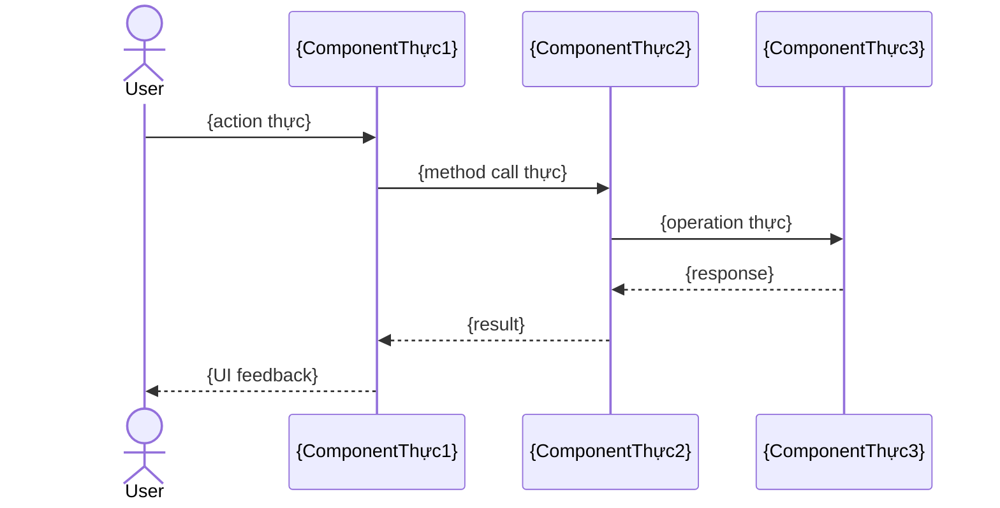

<!-- HEADING MAP — Agent PHẢI dùng CHÍNH XÁC các heading dưới đây:
# Use Cases: {Tên Module}
## 1. Luồng Nghiệp Vụ E2E (End-to-End Flows)
### Flow 1: {Tên luồng chính}
### Flow 2: {Tên luồng phụ}
## 2. Business Rules Chi Tiết
### BR-01: {Tên rule cụ thể}
### BR-02: {Tên rule}
## 3. State Machine
## 4. Actors & Permissions (Tóm tắt)
-->
# Use Cases: {Tên Module}

> **Audience chính**: BA, PO, Domain Expert
> **AI generate**: Draft từ deep code scan → Human bổ sung business context, SLA

---

## 1. Luồng Nghiệp Vụ E2E (End-to-End Flows)

> ⚠️ Mỗi flow phải mô tả CHÍNH XÁC luồng chạy trong code: từ entry point → xử lý → lưu DB → response.
> KHÔNG viết chung chung. Phải ghi rõ file/hàm nào xử lý bước nào.

### Flow 1: {Tên luồng chính}

**Trigger**: {Ai trigger, khi nào}
**Entry point**: `{file_thực}` → hàm `{function_thực}`

**Chi tiết luồng:**

<!-- HƯỚNG DẪN: Mô tả từng bước chạy trong code, dạng:
1. [Layer] Mô tả — File: file_thực:line
2. [Layer] Mô tả — File: file_thực:line
Các layer phổ biến: UI, Controller, Service, Repository, DB, Side-effect, Response
-->

```
1. [{Layer}] {mô tả bước 1} — File: {file_thực}:{line}
2. [{Layer}] {mô tả bước 2} — File: {file_thực}:{line}
3. [{Layer}] {mô tả bước 3} — File: {file_thực}:{line}
```

<!-- HƯỚNG DẪN: Vẽ sequence diagram cho flow phức tạp.
Thay tên participant bằng tên THỰC TẾ từ codebase (class names, file names).
-->



### Flow 2: {Tên luồng phụ}

**Trigger**: {Ai trigger, khi nào}
**Entry point**: `{file_thực}` → hàm `{function_thực}`

**Chi tiết luồng:**
```
1. [{Layer}] {mô tả} — File: {file_thực}:{line}
   ...
```

---

## 2. Business Rules Chi Tiết

> ⚠️ Trích xuất TỪ CODE. Mỗi rule PHẢI có file reference. Không viết chung chung.

### BR-01: {Tên rule cụ thể}

<!-- HƯỚNG DẪN: Mỗi rule phải có:
- Điều kiện: Khi nào rule apply
- Hành động: Hệ thống làm gì
- Code reference: file:line + đoạn code ngắn THỰC TẾ
- Ngoại lệ: Trường hợp ngoại lệ nếu có
-->

- **Điều kiện**: {Khi nào rule apply}
- **Hành động**: {Hệ thống làm gì}
- **Code reference**: `{file_thực}:{line}` — `{đoạn code ngắn thực tế}`
- **Ngoại lệ**: {Trường hợp ngoại lệ nếu có}
- **SLA**: {Thời gian / ràng buộc nếu có} [❓ CẦN HUMAN BỔ SUNG]
- [⚠️ AI-inferred]

### BR-02: {Tên rule}

- **Điều kiện**: ...
- **Hành động**: ...
- **Code reference**: `{file_thực}:{line}`
- [⚠️ AI-inferred]

---

## 3. State Machine

> ⚠️ States và transitions phải lấy TỪ CODE (enum definitions, transition logic). Không bịa.
> Source: `{enum_file_thực}` — enum `{EnumName_thực}`

<!-- HƯỚNG DẪN: Vẽ stateDiagram với states THỰC TẾ từ code.
Lấy từ enum definitions, const values trong codebase.
TUYỆT ĐỐI KHÔNG copy states mẫu (DRAFT, PENDING_APPROVAL, APPROVED...) nếu module không có.
Nếu module không có state machine → ghi rõ "Module không có state machine" và bỏ section này.
-->

```mermaid
stateDiagram-v2
    [*] --> {STATE_1} : {event tạo}
    {STATE_1} --> {STATE_2} : {event chuyển}
    {STATE_2} --> {STATE_3} : {event chuyển}
    {STATE_3} --> [*]
```

| Từ trạng thái | Sang trạng thái | Trigger (Event) | Điều kiện (Guards) | Ai được phép | File reference |
|---|---|---|---|---|---|
| `{STATE_1}` | `{STATE_2}` | {event} | {điều kiện} | {actor} | `{file_thực}:{line}` |

**Side-Effects khi chuyển state:**

| Transition | Side-Effect | File reference |
|---|---|---|
| → `{STATE}` | {mô tả side-effect} | `{file_thực}:{line}` |

---

## 4. Actors & Permissions (Tóm tắt)

> Chi tiết đầy đủ xem [permissions.md](permissions.md)

| Actor (Role) | Quyền trong module | Phạm vi dữ liệu | Ghi chú |
|---|---|---|---|
| `{ROLE_1}` | {quyền} | {phạm vi} | |
| `{ROLE_2}` | {quyền} | {phạm vi} | |
