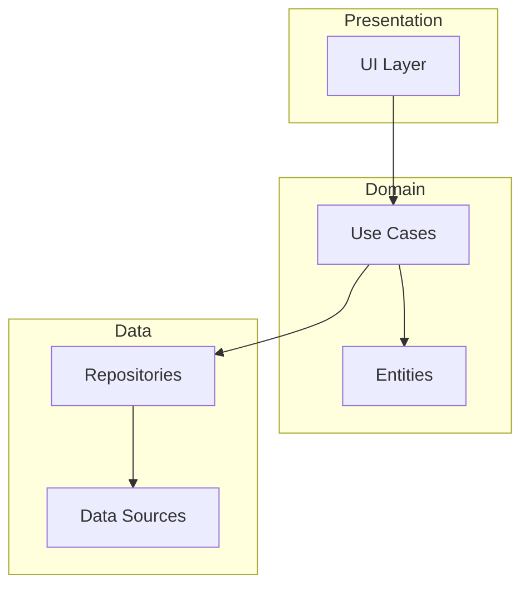
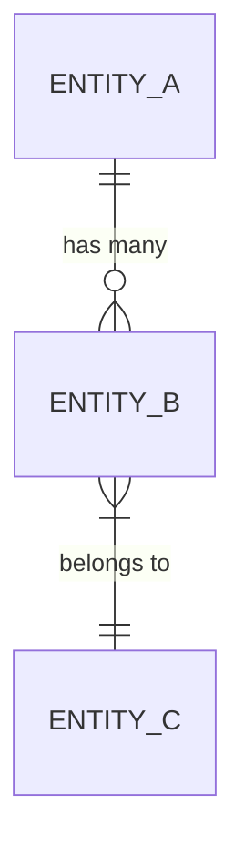
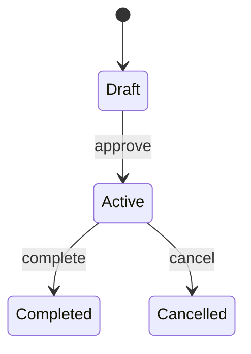

# Template: Technical Plan (Kế hoạch kỹ thuật)

> Được tạo bởi **Plan Agent** từ Specification
> Feature: [TÊN FEATURE]
> Spec Version: [vX.Y]

> **Profile** — **Full** (mặc định): điền mọi section áp dụng. **Lite** (feature `quickfix`/`hotfix` trong `.flow-state.yaml`): tối thiểu §1 (tổng quan) + §6 (File Changes) + §3.4 (nếu đụng DB); **bỏ qua** §10 NFR, §11 Observability, §13 Tech Decisions, §3.5 Key Queries. `v-flow validate` tự **nới** các nudge này cho feature lite (không cảnh báo thiếu).

## 1. Tổng quan kiến trúc

### 1.1 Tóm tắt
<!-- Mô tả tổng quan cách triển khai feature — 3-5 câu -->

### 1.2 Diagram kiến trúc



### 1.3 Components liên quan

| Component | Mô tả | Mới/Sửa | REQ mapping |
|-----------|-------|:-------:|------------|
| | | Mới / Sửa | REQ-xxx |

---

## 2. Tech Stack & Dependencies

### 2.1 Công nghệ sử dụng

| Mục | Lựa chọn | Lý do | Constitution ref |
|-----|---------|-------|:----------------:|
| Framework | | | §1.1 |
| Database | | | §1.1 |
| Libraries | | | — |

### 2.2 Dependencies mới

<!-- Libraries, packages cần thêm -->
- [ ] [package@version] — [lý do] — [impact: bundle size/performance]

---

## 3. Data Model

### 3.1 Entities

<!-- Mô tả các entity / table / collection -->

```
[Entity Name]
├── field1: type (required) — [business meaning]
├── field2: type (optional) — [business meaning]
└── field3: type — [business meaning]
```

### 3.2 Relationships



### 3.3 State Machine (nếu có)



### 3.4 Database Migrations (nếu đụng schema)

> Phân biệt rõ **bảng MỚI** vs **ALTER bảng hiện có**. Bắt buộc điền khi feature thay đổi schema — để dev biết thêm bảng/cột nào, không phải đoán.

| Bảng / Collection | New/ALTER | Cột | Kiểu | Null? | Default | Index / Constraint | REQ |
|-------------------|:---------:|-----|------|:-----:|---------|--------------------|-----|
| `users` | ALTER | `last_login_at` | timestamp | ✅ | null | — | REQ-S01 |
| `audit_log` | NEW | `id`, `user_id`, `action`, `created_at` | — | — | — | PK `id`, idx `user_id` | REQ-O01 |

- **DDL thật (up + rollback)** — câu lệnh copy-paste-được để dev KHÔNG phải đoán. DDL là *đặc tả schema* (không phải code logic) nên không vi phạm "plan không chứa code":

```sql
-- up
ALTER TABLE users ADD COLUMN last_login_at timestamp NULL;
CREATE TABLE audit_log (
  id          bigserial   PRIMARY KEY,
  user_id     bigint      NOT NULL REFERENCES users(id),
  action      text        NOT NULL,
  created_at  timestamptz NOT NULL DEFAULT now()
);
CREATE INDEX idx_audit_log_user_id ON audit_log(user_id);

-- down (rollback)
DROP TABLE audit_log;
ALTER TABLE users DROP COLUMN last_login_at;
```
> Dùng ORM/migration tool (Prisma, TypeORM, Alembic…)? → ghi lệnh tương đương của tool thay cho SQL thô (vẫn phải có up + down cụ thể).

- **Migration file**: `migrations/[YYYYMMDD]_[tên].sql` (hoặc theo ORM/tool của dự án)
- **Rollback**: [cách hoàn tác — drop column / drop table / down migration]
- **Data backfill**: [có cần backfill dữ liệu cũ không? cách làm — bỏ trống nếu không]
- **Breaking change → Expand-Contract** (zero-downtime): nếu ALTER phá tương thích (đổi/bỏ cột, thêm NOT NULL) → tách 3 bước: **(1) Expand** thêm cột mới nullable, ghi cả cũ+mới → **(2) Migrate** backfill + chuyển đọc sang cột mới → **(3) Contract** bỏ cột cũ ở release sau. Mỗi bước là 1 task `[DB]` riêng.

### 3.5 Truy vấn quan trọng (Key Queries)

> Cho các truy vấn có **access pattern không hiển nhiên**: filter, join, phân trang, soft-delete, aggregate… Ghi **hình dạng** (bảng / predicate chính / index dùng) để dev biết "đi đường nào" — KHÔNG cần câu SQL hoàn chỉnh (giữ nguyên tắc "plan không chứa code logic"). Bỏ qua nếu chỉ CRUD đơn giản theo khóa chính.

| Truy vấn (mục đích) | Bảng | Predicate / Filter chính | Index dùng | Ghi chú |
|---------------------|------|--------------------------|-----------|---------|
| Liệt kê bản ghi active (phân trang) | `products` | `WHERE deleted_at IS NULL` + `LIMIT/OFFSET` | `idx_products_deleted_at` | parameterized; KHÔNG string-concat |
| | | | | |

---

## 4. API Design (nếu có)

### 4.1 Endpoints

| Method | Path | New/Sửa | Mô tả | Auth | Request | Response | REQ |
|--------|------|:-------:|-------|:----:|---------|----------|-----|
| | | Mới / Sửa | | ✅/❌ | | | REQ-xxx |

### 4.2 Data Contracts (field-level)

> Field-level cho request/response — KHÔNG cần đợi `--with-api`. Mỗi field: tên / kiểu / bắt buộc / ràng buộc. Lặp block cho mỗi endpoint cần chi tiết. Contract-first (FE+BE) → đóng băng ở `contracts/api-contract.md`.

**`POST /api/x` — Request**

| Field | Kiểu | Bắt buộc | Ràng buộc |
|-------|------|:--------:|-----------|
| `email` | string | ✅ | định dạng email |
| `password` | string | ✅ | ≥ 8 ký tự |

**Response 200**

| Field | Kiểu | Ghi chú |
|-------|------|---------|
| `token` | string | JWT access token |
| `expiresIn` | number | giây |

### 4.3 Error Codes

| Code | HTTP | Mô tả | Khi nào |
|------|:----:|-------|--------|
| | | | |

### 4.4 Thay đổi Contract (nếu SỬA API hiện có)

> Khi sửa endpoint đã tồn tại — ghi rõ field thêm/đổi/bỏ và tính tương thích ngược.

| Endpoint | Field | Thay đổi | Trước | Sau | Breaking? |
|----------|-------|:--------:|-------|-----|:---------:|
| `POST /api/x` | `status` | Thêm | — | `enum(active,locked)` | Không |
| | | Thêm/Đổi/Bỏ | | | Có/Không |

---

## 5. UI / Screen Changes (nếu có giao diện)

> Lấy từ **"Mô tả màn hình"** trong spec (mỗi `UC-xx`). Ghi rõ màn hình nào tạo mới / sửa, sửa gì, component/widget nào, các trạng thái, và token tham chiếu từ `DESIGN.md`. Để dev không phải hỏi "sửa màn nào".

### 5.1 Danh sách màn hình

| Màn hình | UC | New/Sửa | Thay đổi | Component / Widget | Trạng thái (empty/loading/error) | DESIGN token |
|----------|----|:-------:|----------|---------------------|----------------------------------|--------------|
| LoginPage | UC-01 | Mới | Form đăng nhập | email field, password field, submit btn | loading, error-401 | `button-primary`, `input-default` |
| ProductList | UC-03 | Sửa | Thêm cột "Trạng thái" + filter | DataTable, FilterBar | empty, loading | `badge-success`, `badge-error` |

### 5.2 Điều hướng (Navigation flow thay đổi)

<!-- Luồng chuyển màn hình mới hoặc bị thay đổi -->
- `[Màn A]` --(action)--> `[Màn B]`

---

## 6. File Changes

### 6.1 File mới

| File path | Mô tả | LOC ước tính | REQ |
|-----------|-------|:------------:|-----|
| | | | REQ-xxx |

### 6.2 File sửa đổi

> Mỗi dòng phải chỉ rõ **vị trí (hàm/class/widget)** và **hiện trạng → mong muốn** — KHÔNG ghi chung chung "cập nhật logic".

| File path | Vị trí (hàm/class) | Loại | Hiện trạng → Mong muốn | Impact | REQ |
|-----------|--------------------|:----:|------------------------|:------:|-----|
| `src/auth/service.ts` | `AuthService.login()` | Sửa logic | Trả 200 ngay → validate role trước khi cấp token | Med | REQ-E01 |
| `lib/ui/product_page.dart` | `ProductPage.build()` | Thêm UI | Chưa có filter → thêm `FilterBar` widget | Low | REQ-S02 |
| | | Thêm/Sửa/Xóa/Refactor | | Low/Med/High | REQ-xxx |

---

## 7. Rủi ro kỹ thuật

| Mã | Rủi ro | Xác suất | Ảnh hưởng | Giải pháp | REQ liên quan |
|----|--------|:--------:|:---------:|----------|:-------------:|
| R-01 | | Cao/Trung/Thấp | Cao/Trung/Thấp | | REQ-xxx |

> Task gắn `[RISKY]`/`[SPIKE]` nên tham chiếu mã rủi ro (vd `Risk: R-01`) để truy vết hai chiều.

---

## 8. Constitution Compliance Check

> Plan Agent tự kiểm tra plan tuân thủ constitution

| Nguyên tắc Constitution | Plan tuân thủ? | Ghi chú |
|------------------------|:--------------:|---------|
| Architecture pattern (§1) | ✅ / ❌ | |
| Naming convention (§2) | ✅ / ❌ | |
| Testing standards (§2.2) | ✅ / ❌ | |
| API standards (§4) | ✅ / ❌ / N/A | |

---

## 9. No-Go Zone Verification

> Nếu legacy project có context.md

| No-Go Zone | Plan đụng? | Ghi chú |
|-----------|:----------:|---------|
| [zone 1 từ context.md] | ✅ Safe / ❌ Violated | |

---

## 10. Non-Functional Requirements (NFR)

> Lấy từ **"Yêu cầu đặc biệt"** của mỗi `UC-xx` trong spec (hiệu năng / bảo mật / khả dụng-a11y / tuân thủ-audit). Mỗi NFR phải có **cách plan đáp ứng** + **task/kiểm chứng** — để không rơi rụng khi implement.

| NFR | Loại | Yêu cầu (từ spec) | Cách plan đáp ứng | Verify (task/test) | UC/REQ |
|-----|------|-------------------|-------------------|--------------------|--------|
| Hiệu năng | Perf | p95 < 2s | cache + index phù hợp | TC perf budget | UC-01 |
| Khả dụng | A11y | keyboard + screen reader | semantics/label widget | tiêu chí task `[UI]` | UC-01 |
| Tuân thủ | Audit | log mọi thao tác ghi | audit interceptor | task `[LOGIC]` | UC-02 |

---

## 11. Observability & Rollout (nếu lên production)

> Cho feature chạy thật: làm sao **biết nó hoạt động/đổ vỡ**, và **tung ra an toàn**. Gieo mầm cho Metrics/Operations agent hạ nguồn.

- **Feature flag**: [tên cờ + default + cách bật dần]
- **Metrics cần emit**: [counter / latency p95 / error-rate — tên metric cụ thể]
- **Logs**: [sự kiện log mức info/error — KHÔNG log dữ liệu nhạy cảm]
- **Alerts**: [ngưỡng cảnh báo — vd error-rate > 1% trong 5 phút]
- **Rollout**: [canary / % traffic / điều kiện rollback]

---

## 12. Giả định & Câu hỏi mở (Assumptions & Open Questions)

> Gom về **một chỗ** mọi giả định thiết kế và điểm chưa chắc — để Master Check (R.0) và human review thấy ngay, thay vì rải rác trong từng task. Mỗi task `[CLARIFY]` PHẢI có câu hỏi tương ứng ở đây.

### 12.1 Giả định thiết kế (Assumptions)

> Điều plan đang **mặc định là đúng** mà chưa được xác nhận. Nếu sai → phải re-plan.

| Mã | Giả định | Tác động nếu sai | Cần ai xác nhận |
|----|----------|------------------|-----------------|
| A-01 | [VD: API trả 401 cho cả sai mật khẩu lẫn khóa tài khoản] | [phải tách 2 luồng lỗi] | [Backend lead] |

### 12.2 Câu hỏi mở (Open Questions — gom từ task `[CLARIFY]`)

> Mỗi dòng map tới task `[CLARIFY]`. Implement Agent KHÔNG được đoán — phải hỏi trước khi code.

| Câu hỏi | Task liên quan | Chặn implement? | Người trả lời |
|---------|----------------|:---------------:|---------------|
| [VD: Lockout 5 lần theo IP hay theo account?] | T-0xx | ✅ | [Product owner] |

---

## 13. Tech Decisions & Alternatives (Quyết định kỹ thuật)

> **WHY** của plan: vì sao chọn cách này, đã **cân nhắc & loại** phương án nào. Để người review và Implement Agent không mở lại tranh luận đã chốt. Mỗi quyết định không tầm thường → 1 dòng.

| Mã | Quyết định | Lý do chọn | Phương án đã cân nhắc & loại | Đánh đổi chấp nhận |
|----|-----------|-----------|------------------------------|--------------------|
| D-01 | [VD: BLoC cho state mgmt] | constitution §3.2 + dễ test | Provider (ít boilerplate, yếu test), setState (không scale) | nhiều boilerplate hơn |
| D-02 | | | | |

---

> **Trạng thái**: Draft / Reviewed / Approved
> **Người review**: [Tech Lead]
> **Ngày review**: [YYYY-MM-DD]
