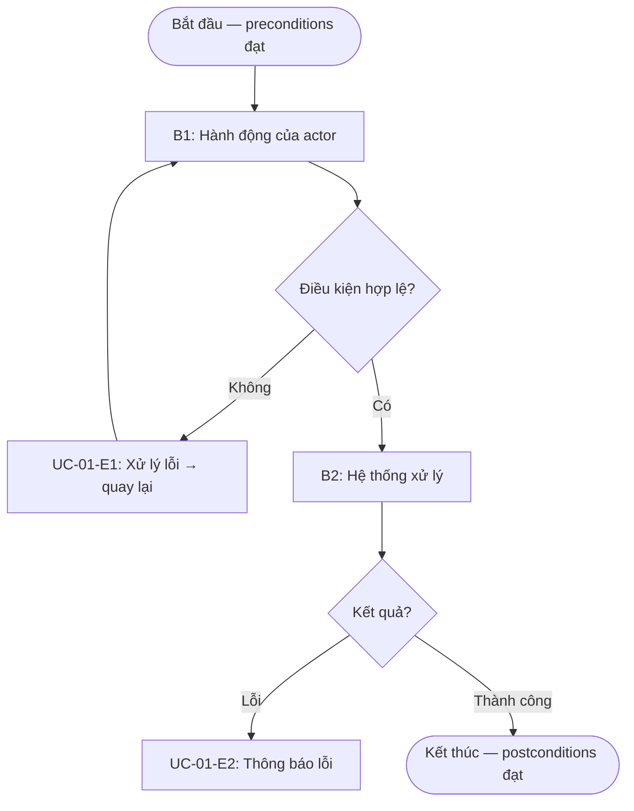
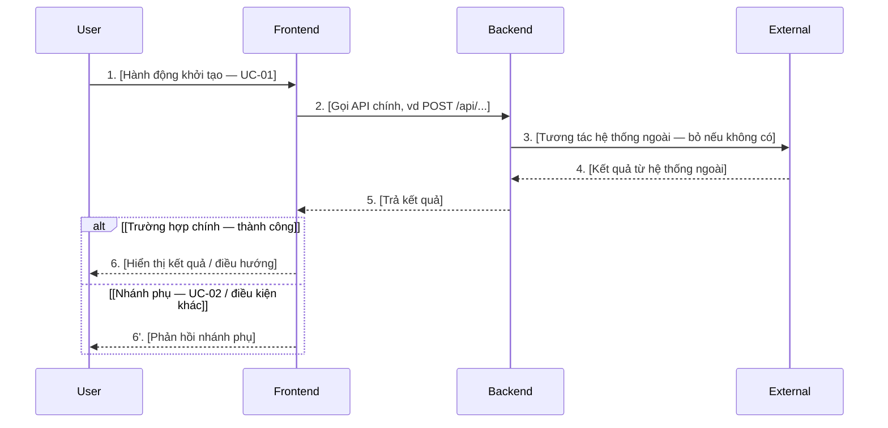

# Template: Specification (Đặc tả kỹ thuật)

> 📌 **Single Source of Truth** — Spec thắng khi có conflict với plan/tasks/tests.
> Được tạo bởi **BA Agent** từ yêu cầu đầu vào
> Feature: [TÊN FEATURE]

## 1. Tổng quan

### 1.1 Mô tả ngắn gọn
<!-- 1-2 câu mô tả feature này làm gì -->

### 1.2 Động lực (Motivation)
<!-- Tại sao cần feature này? Giải quyết vấn đề gì? -->

### 1.3 Actors (Đối tượng liên quan)
<!-- Ai sử dụng feature? Vai trò của họ? -->

| Actor | Mô tả | Quyền hạn |
|-------|-------|----------|
| | | |

---

## 2. Đặc tả Use Case chi tiết (Use Case Specification)

> Mỗi use case mô tả **một mục tiêu hoàn chỉnh** của một actor.
> Đánh mã `UC-01`, `UC-02`... để Plan / Test / Requirements tham chiếu.
> **Lặp lại block dưới đây cho mỗi use case** của feature.
> Mỗi UC có **Workflow (sơ đồ luồng)** trực quan hoá Main Flow + ngoại lệ; cuối mục có **Sequence Diagram tổng thể** thể hiện tương tác kỹ thuật của cả feature.

### UC-01: [Tên use case — động từ + đối tượng]

| Thuộc tính | Nội dung |
|-----------|----------|
| **Mã** | UC-01 |
| **Mô tả tính năng** | <!-- 1-3 câu: use case này cho phép actor làm gì, đạt mục tiêu gì --> |
| **Tác nhân chính** | [Actor khởi tạo use case] |
| **Tác nhân phụ** | [Hệ thống ngoài / actor hỗ trợ — để trống nếu không có] |
| **Độ ưu tiên** | Cao / Trung bình / Thấp |
| **Tần suất sử dụng** | [VD: hàng ngày / mỗi lần đăng nhập / hiếm] |

**Điều kiện trước (Preconditions)** — phải đúng TRƯỚC khi use case bắt đầu:
- [ ] [VD: Actor đã đăng nhập và có quyền X]
- [ ] [VD: Tồn tại ít nhất 1 bản ghi trong danh sách]

**Điều kiện sau (Postconditions)** — đảm bảo SAU khi use case kết thúc thành công:
- [ ] [VD: Bản ghi mới được lưu và hiển thị trong danh sách]
- [ ] [VD: Audit log được ghi lại]

**Luồng sự kiện chính (Main Flow)** — happy path, mô tả hành động của tác nhân & phản ứng của hệ thống:

| # | Hành động của tác nhân | Phản ứng của hệ thống |
|---|------------------------|------------------------|
| 1 | [Actor làm gì] | [Hệ thống đáp lại thế nào] |
| 2 | | |
| 3 | | |

**Luồng ngoại lệ & thay thế (Exceptions / Alternative Flows)**:

| Mã | Tại bước | Điều kiện kích hoạt | Xử lý của hệ thống |
|----|----------|---------------------|---------------------|
| UC-01-E1 | B2 | [VD: Email sai định dạng] | [VD: Hiển thị lỗi inline, giữ nguyên dữ liệu form] |
| UC-01-A1 | B3 | [VD: Actor chọn "Lưu nháp"] | [VD: Lưu trạng thái draft, bỏ qua validate đầy đủ] |

**Workflow (sơ đồ luồng)** — trực quan hoá Main Flow + điểm rẽ nhánh + ngoại lệ trong **một** use case này:

> Quy ước: chữ nhật = bước `Bn` (khớp số ở bảng Main Flow), hình thoi = điểm rẽ nhánh/quyết định, node lỗi map đúng **mã ngoại lệ** ở bảng Exceptions (`UC-01-Ex`). Một flowchart cho mỗi UC; chi tiết validate/lỗi vẫn nằm ở bảng, flowchart chỉ làm rõ luồng.

**Yêu cầu đặc biệt (Special Requirements / NFR)** — phi chức năng gắn với use case này:
- **Hiệu năng**: [VD: Phản hồi < 2s với 95% request]
- **Bảo mật / Phân quyền**: [VD: Chỉ role Admin được thực hiện]
- **Khả dụng / UX**: [VD: Hỗ trợ điều hướng bàn phím, screen reader]
- **Tuân thủ / Audit**: [VD: Ghi log mọi thao tác ghi dữ liệu]

**Mô tả màn hình (Screen / UI)**:

| Màn hình | Mục đích | Thành phần chính | Trạng thái & điều hướng |
|----------|----------|------------------|--------------------------|
| [Tên màn hình] | [Dùng để làm gì] | [Các field, nút, bảng, thông báo...] | [Empty / Loading / Error / Success → đi đâu tiếp] |

**🖼️ UI Intent (contract giao diện)** — điền khi UC có giao diện. Đây là *carrier của contract UI* mà Plan / Prototype / Implement / Review bám theo:

| Thuộc tính | Nội dung |
|-----------|----------|
| **Mockup nguồn** | [`docs/PYC-xxx.pdf#p4` \| `figma:<link>` \| (không có)] — *con trỏ do BA ghi, KHÔNG trích ảnh* |
| **Ảnh đã ingest** | `ui/mockups/UC-NN-*.png` — *prototype `--from-mockup` dựng / hoặc human đặt vào (để trống ở spec)* |
| **Kế thừa trang** | [`/route` hiện có cần đồng bộ phong cách \| (màn hình mới)] |
| **Bố cục (layout)** | [mô tả vùng theo ý đồ mockup: header / body / footer / sidebar...] |
| **Mức ràng buộc** | `Định hướng` (khớp layout/thành phần/luồng) \| `Bắt buộc` (pixel) — *mặc định: Định hướng* |
| **Render đã chốt** | `ui/approved/UC-NN.*` — Prototype S.1.5 `--from-mockup` dựng qua `DESIGN.md` (để trống nếu chưa dựng) |

> ⚠️ Mockup quản **cấu trúc** (layout / thành phần / luồng). Style **bắt buộc** lấy từ `DESIGN.md` — KHÔNG copy màu/spacing/font trực tiếp từ ảnh.

---

### UC-02: [Tên use case]

<!-- Lặp lại đầy đủ cấu trúc như UC-01 cho mỗi use case còn lại -->

---

### Sequence Diagram — Tương tác tổng thể (feature)

> **Một** sequence diagram end-to-end cho **cả feature** — thể hiện tương tác **User – FE – BE – External/Partner** theo thời gian (KHÔNG đưa Database object).
> Vẽ **luồng thành công (happy path)** làm chính; nhánh phụ / secondary use-case dùng `alt` / `opt`. Validate & xử lý lỗi chi tiết để ở **Workflow từng UC** + bảng Exceptions — **không lặp lại** ở đây.
> Quy ước (theo skill `ba-sequence-spec`): alias participant **ASCII** (`User`/`FE`/`BE`/`Partner`), mỗi message **1 dòng có đánh số**, không dùng `'` `"` hay `\n`.

> 🔗 **Mapping:** mỗi nhánh chính của diagram ứng với một use-case (UC-01, UC-02...); chi tiết từng bước nằm ở **Workflow** của UC tương ứng. Đặc tả API (Request/Response/Error/Status) thuộc `plan.md` (§4 API Design / Data Contracts), không lặp ở spec.

---

## 3. Requirements (Yêu cầu — Ký pháp EARS)

### 3.1 Yêu cầu phổ quát (Ubiquitous)
<!-- Hệ thống phải <action> -->
- **REQ-U01**: Hệ thống phải [yêu cầu]
- **REQ-U02**: ...

### 3.2 Yêu cầu theo sự kiện (Event-driven)
<!-- Khi <trigger>, hệ thống phải <action> -->
- **REQ-E01**: Khi [sự kiện], hệ thống phải [hành động]
- **REQ-E02**: ...

### 3.3 Yêu cầu theo trạng thái (State-driven)
<!-- Trong khi <state>, hệ thống phải <action> -->
- **REQ-S01**: Trong khi [trạng thái], hệ thống phải [hành động]
- **REQ-S02**: ...

### 3.4 Yêu cầu có điều kiện (Optional)
<!-- Nếu <condition>, hệ thống phải <action> -->
- **REQ-O01**: Nếu [điều kiện], hệ thống phải [hành động]
- **REQ-O02**: ...

---

## 4. Acceptance Criteria (Tiêu chí chấp nhận)

> Mỗi tiêu chí có **mã `AC-NN`** (đánh số toàn spec) để task `Done khi` tham chiếu chính xác, và Master Check / validator cross-check coverage (**mọi AC phải có ≥1 task**). Mỗi REQ cần ≥1 AC.

| Mã | Use Case | Requirement | Tiêu chí | Cách kiểm tra |
|----|----------|------------|---------|---------------|
| AC-01 | UC-01 | REQ-U01 | [Tiêu chí cụ thể] | [Cách verify] |
| AC-02 | UC-01 | REQ-E01 | | |

---

## 5. Ràng buộc & Giả định

### 5.1 Ràng buộc (Constraints)
- [ ] [Ràng buộc kỹ thuật, business...]

### 5.2 Giả định (Assumptions)
- [ ] [Các giả định đang áp dụng]

### 5.3 Ngoài phạm vi (Out of Scope)
- [ ] [Những gì KHÔNG thuộc feature này]

---

## 6. Rủi ro & Phụ thuộc

| Rủi ro / Phụ thuộc | Mức độ | Giải pháp |
|--------------------|--------|----------|
| | Cao/Trung/Thấp | |

---

## 7. Status (Single Source of Truth Tracker)

> ⚠️ Mọi Agent đọc file này PHẢI kiểm tra Status trước khi hành động.
> Khi spec thay đổi, **BA Agent** phải bump `Spec Version` và reset trạng thái các artifact

| Thông tin | Giá trị |
|-----------|--------|
| **Spec Version** | v1.0 |
| **Trạng thái** | `Draft` / `Reviewed` / `Approved` |
| **Người approve** | [Tên] |
| **Ngày approve** | [YYYY-MM-DD] |

### Artifact Sync Status

> Sau khi spec thay đổi, cập nhật bảng này. ❌ = cần sync lại, ✅ = đã sync, N/A = chưa tạo

| Artifact | Synced to Spec | Trạng thái | Ghi chú |
|----------|---------------|------------|--------|
| `ui/mockups/` | v0.0 | N/A | Ảnh mockup — prototype/human đặt (nếu có UI) |
| `ui/approved/` | v0.0 | N/A | Render đã chốt — Prototype `--from-mockup` (nếu có UI) |
| `plan.md` | v0.0 | N/A | Chưa tạo |
| `tasks.md` | v0.0 | N/A | Chưa tạo |
| `test-cases.md` | v0.0 | N/A | Chưa tạo |
| `validation-report.md` | v0.0 | N/A | Chưa tạo |

### Changelog

| Version | Ngày | Thay đổi | Người thực hiện |
|---------|------|----------|------------------|
| v1.0 | [YYYY-MM-DD] | Tạo mới | BA Agent |

