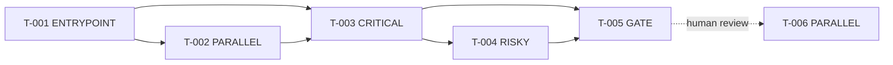

# Template: Task Breakdown

> Được tạo bởi **Plan Agent** từ Technical Plan
> Feature: [TÊN FEATURE]

> **Profile** — **Full** (mặc định). **Lite** (`quickfix`/`hotfix`): mỗi task VẪN cần Type + `Done khi` (AC) + block TDD; được phép bỏ Dependency Graph / Execution Schedule / Task Overview nếu chỉ 1–2 task.

## Quy ước

### Status marks
- `[ ]` = Chưa thực hiện
- `[/]` = Đang thực hiện
- `[x]` = Hoàn thành

### Task ID
- Dùng **một** quy ước duy nhất: `T-001`, `T-002`, … (`T-NNN`, 3 chữ số).
- Tham chiếu trong dependency: `[DEPENDS: T-003]`.

### Task Annotations (Functional API)

> Lấy cảm hứng từ LangGraph @entrypoint/@task decorators.
> Giúp Implement Agent biết cách schedule tasks tối ưu.

| Annotation | Ý nghĩa | Ví dụ |
|------------|---------|-------|
| `[ENTRYPOINT]` | Task khởi đầu — phải làm đầu tiên | Setup database, init project |
| `[PARALLEL]` | **Độc lập** — không phụ thuộc task khác cùng phase (an toàn để đổi thứ tự/gộp). KHÔNG ngụ ý chạy đồng thời trừ khi có orchestrator spawn subagent | Feature A và B không đụng nhau |
| `[DEPENDS: T-xxx]` | Phụ thuộc task cụ thể — chỉ bắt đầu khi T-xxx xong | Integration test phụ thuộc vào code |
| `[GATE]` | Checkpoint — dừng lại chờ human review trước khi tiếp | Sau core logic, trước integration |
| `[CRITICAL]` | Task trên critical path — ưu tiên cao nhất | Auth logic cho toàn bộ feature |
| `[RISKY]` | Task có rủi ro cao — cần test kỹ hơn | 3rd-party API integration |
| `[SPIKE]` | Task điều tra / POC — chưa biết cách làm; output là **quyết định/kết luận** (không phải code production), time-boxed | Thử 2 thư viện + benchmark trước khi chọn |
| `[CLARIFY]` | Còn điểm mơ hồ — Implement Agent PHẢI hỏi human trước khi code, không tự đoán | Spec chưa rõ business rule, thiếu input/edge case |

> **Mặc định tuần tự**: task KHÔNG gắn `[PARALLEL]` sẽ chạy lần lượt theo dependency order. Không cần nhãn riêng cho "tuần tự" — `[DEPENDS]` đã diễn đạt thứ tự.
> **`[CLARIFY]` = chặn đoán mò**: thà gắn `[CLARIFY]` + ghi "Câu hỏi mở" còn hơn để Implement Agent giả định sai. Plan có `[CLARIFY]` chưa nên coi là "ready" hoàn toàn.

### Seam tags (Slice Planning — B.0c, tuỳ chọn)

> Giúp `v-flow slice` cắt feature thành lát dọc. Gắn khi biết; thiếu tag thì seam tương ứng không áp dụng (không báo lỗi).

| Tag | Ý nghĩa | Ví dụ |
|-----|---------|-------|
| `[FOUNDATION]` | Nền không phục vụ luồng nào → SLICE-0 | Schema, auth middleware, khung dự án |
| `[EXTERNAL]` | Phụ thuộc hệ thống ngoài (slice chứa nó là HITL) | Cổng thanh toán, SSO của đối tác |
| `[RESILIENCE]` | Retry / fallback — phải đi cùng task đầu tiên dùng nó | Retry gọi cổng thanh toán |
| `[READ: Đối tượng]` / `[WRITE: Đối tượng]` | Đọc / ghi một đối tượng (seam `read-write`) | `[READ: Order]`, `[WRITE: Order]` |

### Dependency notation
- `depends: T-xxx` = phải hoàn thành T-xxx trước
- `depends: T-xxx, T-yyy` = phải hoàn thành cả hai

### Task Type — Loại thay đổi (BẮT BUỘC mỗi task)

> Cho Implement Agent biết task đụng **bề mặt nào** → biết cần chi tiết gì để không phải hỏi lại.

| Type | Khi nào dùng | Phải ghi rõ thêm |
|------|--------------|------------------|
| `[UI]` | Thêm/sửa màn hình, component | Màn hình, widget/component, trạng thái, token `DESIGN.md` |
| `[API]` | Thêm/sửa endpoint | Method + path, field request/response thêm/đổi |
| `[DB]` | Thêm/ALTER bảng, migration | Bảng, cột (tên/kiểu/null/default), **DDL up+down (câu lệnh thật)**, file migration, rollback |
| `[LOGIC]` | Business logic, use case, service | Hàm/class, hiện trạng → mong muốn |
| `[REFACTOR]` | Đổi cấu trúc, KHÔNG đổi behavior | Phạm vi, đảm bảo test cũ vẫn pass |
| `[TEST]` | Viết test, integration/E2E | Loại test, kịch bản |

### Complexity — Độ phức tạp (thay cho ước tính giờ)

> Executor là AI agent → "mất bao nhiêu giờ" không còn ý nghĩa. Dùng tier độ phức tạp để biết task nào cần tách / cần soi kỹ.

| Tier | Nghĩa | Dấu hiệu | Điểm (sizing) |
|:----:|-------|----------|:-------------:|
| **S** | Nhỏ, đường đi rõ | 1 component/file · ~1 TDD cycle · không nhánh phức tạp | 1 |
| **M** | Vừa | 1 component nhưng nhiều nhánh/trạng thái · 2–3 TDD cycle · vài quyết định | 2 |
| **L** | Lớn | Chạm nhiều file liên quan · logic/edge case phức tạp · tích hợp ngoài | 4 |

- Task ở mức **L** → cân nhắc tách nhỏ. Nếu không tách được → gắn `[RISKY]` và nêu lý do.
- **Sizing tổng** = Σ điểm (S=1, M=2, L=4). Dùng để quyết định chia milestone: tổng > **~24 điểm** (hoặc > 20 task) → cân nhắc tách thành nhiều phase/milestone.

### Cấu trúc mỗi task (bắt buộc)

> Task **SỬA** code có sẵn PHẢI có `Vị trí` + `Hiện trạng → Mong muốn`. Task tạo **MỚI** thì bỏ "Hiện trạng".
>
> **Phân biệt 3 trường test/done** (bổ sung nhau, không thay thế nhau):
> - `Done khi` = bám **Acceptance Criteria (`AC-NN`)** spec §4 — ghi rõ mã AC; định nghĩa "xong" nghiệp vụ (không chỉ "test pass"). Mọi AC-NN phải được ≥1 task phủ.
> - `Test liên quan: TC-xx` = trỏ tới **test chính thức** ở `test-cases.md` (Test Agent tạo ở B.0b, song song — provisional lúc plan, R.0 backfill).
> - `TDD` = checklist **Red→Green** ngay trong task để Implement Agent code theo: viết test fail trước, rồi code tối thiểu cho pass.

```markdown
#### T-NNN: [Tên cụ thể] `[TYPE]` `[ANNOTATIONS]`
- **Mô tả**: [Mục tiêu task — 1 câu]
- **Files**: `path/to/file.ext`
- **Vị trí (symbol)**: `ClassName.method()` / `WidgetName` / `METHOD /path`  ← cho task SỬA
- **Thay đổi cụ thể**:
  - Hiện trạng: [behavior/code hiện tại — bỏ trống nếu tạo mới]
  - Mong muốn: [kết quả sau khi xong]
  - Các bước: 1) … 2) … 3) …
- **[UI]** (nếu Type=UI): Màn hình `X` · component `Y` · trạng thái `loading/error` · token `button-primary`
- **[API]** (nếu Type=API): `POST /api/x` · thêm field `status` vào response
- **[DB]** (nếu Type=DB): `users` ALTER `last_login_at timestamp null` · **DDL**: `ALTER TABLE users ADD COLUMN last_login_at timestamp NULL;` (up) / `ALTER TABLE users DROP COLUMN last_login_at;` (down) · migration `..._add_last_login.sql`
- **Truy vấn** (nếu query không hiển nhiên): trỏ plan §3.5 — vd `products WHERE deleted_at IS NULL` + index `idx_products_deleted_at`
- **Dependency**: T-xxx (hoặc Không)
- **REQ / UC mapping**: REQ-xxx (UC-xx.main, UC-xx-E1)  ← ghi tới **mức luồng**; chỉ ghi `UC-xx` = phục vụ mọi luồng của UC
- **Done khi**: đáp ứng **AC-NN** tương ứng trong spec §4 (ghi rõ mã, không chỉ "test pass")
- **Test liên quan**: TC-xx
- **TDD** (Red→Green) — viết test TRƯỚC, rồi code cho pass:
  - [ ] Test: [kịch bản 1 — chạy fail trước khi có code]
  - [ ] Test: [kịch bản 2]
  - [ ] Impl: [code tối thiểu để các test trên pass]
- **Complexity**: S / M / L
- **Câu hỏi mở** (chỉ khi `[CLARIFY]`): [điều cần human làm rõ trước khi implement]
- **Trạng thái**: [ ]
```

> 1 task có thể có nhiều type nếu cùng 1 component (vd `[API]` + `[DB]`); nếu tách được nên tách để dễ review.

---

## Task Overview

> Bảng tổng quan ở đầu file — đọc lướt là nắm được quy mô + critical path.

| Tổng tasks | `[PARALLEL]` | `[CRITICAL]` | `[RISKY]` | `[GATE]` | Critical path | Phân bố Complexity | Sizing (Σ điểm) |
|:----------:|:------------:|:------------:|:---------:|:--------:|:-------------:|:------------------:|:---------------:|
| [N] | [N] | [N] | [N] | [N] | T-001→T-003→… | S:[N] · M:[N] · L:[N] | [Σ] |

| Phân bố Type | `[UI]` | `[API]` | `[DB]` | `[LOGIC]` | `[REFACTOR]` | `[TEST]` |
|--------------|:------:|:-------:|:------:|:---------:|:------------:|:--------:|
| Số task | [N] | [N] | [N] | [N] | [N] | [N] |

---

## Tasks

> **Phase grouping là tùy chọn** — gom theo phase khi feature lớn; feature nhỏ có thể liệt kê phẳng.

### Phase A: Setup & Foundation

#### T-001: [vd: Migration thêm cột last_login] `[DB]` `[ENTRYPOINT]`
- **Mô tả**: [Mục tiêu — 1 câu]
- **Files**: `migrations/[YYYYMMDD]_[tên].sql`
- **Thay đổi cụ thể**:
  - Mong muốn: [trạng thái schema sau migration]
  - Các bước: 1) … 2) …
- **[DB]**: `[bảng]` `NEW/ALTER` · cột `[tên] [kiểu] [null?] [default]` · index `[…]` · **DDL**: `ALTER TABLE …;` (up) / `… DROP …;` (down) · rollback `[…]`
- **Dependency**: Không
- **REQ / UC mapping**: REQ-S01 (UC-01)
- **Done khi**: AC tương ứng spec §4 (schema đúng + rollback chạy được)
- **Test liên quan**: TC-xx
- **TDD** (Red→Green):
  - [ ] Test: cột tồn tại sau migration, default đúng
  - [ ] Impl: ALTER TABLE + index
- **Complexity**: S
- **Trạng thái**: [ ]

#### T-002: [vd: Endpoint POST /api/x] `[API]` `[PARALLEL]`
- **Mô tả**: [Mục tiêu]
- **Files**: `path/to/route.ext`
- **Vị trí (symbol)**: `METHOD /api/x` ← nếu sửa endpoint cũ
- **Thay đổi cụ thể**:
  - Hiện trạng: [bỏ trống nếu endpoint mới]
  - Mong muốn: [request/response cuối cùng]
  - Các bước: 1) … 2) …
- **[API]**: `POST /api/x` · request `{…}` · response thêm field `[…]`
- **Dependency**: T-001
- **REQ / UC mapping**: REQ-E01 (UC-01)
- **Done khi**: AC tương ứng spec §4
- **Test liên quan**: TC-xx
- **TDD** (Red→Green):
  - [ ] Test: request hợp lệ → 200 + body đúng schema
  - [ ] Test: input sai → 400 + error envelope
  - [ ] Impl: handler + validation
- **Complexity**: M
- **Trạng thái**: [ ]

---

### Phase B: Core Implementation

#### T-003: [vd: Sửa AuthService validate role] `[LOGIC]` `[CRITICAL]`
- **Mô tả**: [Mục tiêu]
- **Files**: `src/auth/service.ext`
- **Vị trí (symbol)**: `AuthService.login()`
- **Thay đổi cụ thể**:
  - Hiện trạng: [code hiện tại làm gì]
  - Mong muốn: [sau khi sửa]
  - Các bước: 1) … 2) … 3) …
- **Dependency**: T-001, T-002
- **REQ / UC mapping**: REQ-E01 (UC-01)
- **Done khi**: AC tương ứng spec §4
- **Test liên quan**: TC-xx
- **TDD** (Red→Green):
  - [ ] Test: role hợp lệ → cấp token
  - [ ] Test: role không hợp lệ → ném ForbiddenError, không cấp token
  - [ ] Impl: chèn bước check role trước khi cấp token
- **Complexity**: M
- **Trạng thái**: [ ]

#### T-004: [vd: Tích hợp payment gateway] `[LOGIC]` `[RISKY]` `[DEPENDS: T-003]`
- **Mô tả**: [Mục tiêu — rủi ro: 3rd-party API]
- **Files**: `path/to/file.ext`
- **Vị trí (symbol)**: `[class/hàm]`
- **Thay đổi cụ thể**:
  - Mong muốn: […]
  - Các bước: 1) … 2) …
- **Dependency**: T-003
- **REQ / UC mapping**: REQ-E02 (UC-02)
- **Done khi**: AC tương ứng spec §4
- **Test liên quan**: TC-xx
- **TDD** (Red→Green):
  - [ ] Test: gọi gateway thành công → trạng thái paid
  - [ ] Test: gateway timeout/fail → chạy fallback, không mất tiền
  - [ ] Impl: client + retry + fallback
- **Risk**: R-0x (plan §7) — [rủi ro cụ thể]
- **Fallback plan**: [làm gì nếu fail]
- **Complexity**: L
- **Trạng thái**: [ ]

---

### Phase C: Integration & Polish

#### T-005: [vd: Thêm filter vào ProductList] `[UI]` `[GATE]`
- **Mô tả**: [Mục tiêu — DỪNG sau bước này để human review]
- **Files**: `lib/ui/product_page.ext`
- **Vị trí (symbol)**: `ProductPage.build()`
- **Thay đổi cụ thể**:
  - Hiện trạng: [màn hiện chưa có filter]
  - Mong muốn: [thêm FilterBar + cột trạng thái]
  - Các bước: 1) … 2) …
- **[UI]**: Màn hình `ProductList` (UC-xx) · component `FilterBar`, `DataTable` · trạng thái `empty/loading` · token `badge-success`, `input-default`
- **Dependency**: T-003, T-004
- **REQ / UC mapping**: REQ-S02 (UC-03)
- **Done khi**: AC tương ứng spec §4
- **Test liên quan**: TC-xx
- **TDD** (Red→Green):
  - [ ] Test: render FilterBar + cột trạng thái
  - [ ] Test: chọn filter → list lọc đúng; danh sách rỗng → empty state
  - [ ] Impl: widget + bind state
- **Gate condition**: [điều kiện cần đáp ứng trước khi tiếp]
- **Complexity**: M
- **Trạng thái**: [ ]

#### T-006: [vd: Integration test luồng X] `[TEST]` `[PARALLEL]` `[DEPENDS: T-005]`
- **Mô tả**: [Mục tiêu]
- **Files**: `test/...`
- **Thay đổi cụ thể**:
  - Mong muốn: [kịch bản test pass]
  - Các bước: 1) … 2) …
- **Dependency**: T-005
- **REQ / UC mapping**: REQ-S02 (UC-03)
- **Done khi**: E2E luồng X pass + AC liên quan
- **Test liên quan**: TC-xx
- **TDD** (Red→Green):
  - [ ] Test: luồng happy path end-to-end
  - [ ] Test: luồng lỗi (401/timeout) hiển thị đúng
- **Complexity**: S
- **Trạng thái**: [ ]

---

## Dependency Graph



---

## Execution Schedule (cho Implement Agent)

> **"Parallel?"** ở đây = các task trong round **độc lập** (không phụ thuộc lẫn nhau) nên có thể làm theo bất kỳ thứ tự / gộp review. Một Implement Agent đơn vẫn chạy **tuần tự**; chỉ thực sự đồng thời nếu orchestrator spawn nhiều subagent. Cột này KHÔNG bắt buộc chạy song song.

| Round | Tasks | Độc lập? | Ghi chú |
|:-----:|-------|:---------:|---------|
| 1 | T-001 `[ENTRYPOINT]` | ❌ | bắt đầu |
| 2 | T-002 `[PARALLEL]`, T-003 `[CRITICAL]` | ✅ | T-003 ưu tiên |
| 3 | T-004 `[RISKY]` | ❌ | nếu fail → chạy fallback plan |
| 4 | T-005 `[GATE]` | ❌ | DỪNG, chờ human review |
| 5 | T-006 `[PARALLEL]` | ✅ | sau gate approved |
